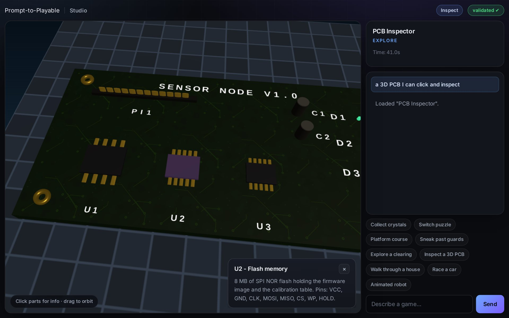

# Prompt-to-Playable Game

**Landing page:** https://prompt-to-playable-steel.vercel.app · **Studio:** https://prompt-to-playable-steel.vercel.app/app.html · **Repo:** https://github.com/bolajiev/prompt-to-playable

<p>
  
</p>

Turn a plain-language prompt into a playable 3D browser game with **working logic** — then keep shaping it by chatting: *"add a second guard and a timer"*, *"raise the platforms"*, *"make the door open on a pressure plate"*.

The architecture is **schema-first and data-driven**. The LLM emits a validated JSON game document; a fixed, deterministic TypeScript engine executes it. No generated code ever runs.

- **Demo video (66 s, captioned):** [`docs/submission/demo.mp4`](docs/submission/demo.mp4)
- **Deployment:** [`docs/deployment.md`](docs/deployment.md)
- **Spec:** [`docs/superpowers/specs/2026-10-09-prompt-to-playable-game-design.md`](docs/superpowers/specs/2026-10-09-prompt-to-playable-game-design.md)
- **Implementation plan:** [`docs/superpowers/plans/2026-10-09-prompt-to-playable-game.md`](docs/superpowers/plans/2026-10-09-prompt-to-playable-game.md)
- **Submission description:** [`docs/submission/description.md`](docs/submission/description.md)
- **Demo script:** [`docs/submission/demo-script.md`](docs/submission/demo-script.md)

## What it is

A single JSON document describes the entire game: `meta`, `world`, `entities`, `objectives`, `rules`, and a mutable `scratch` bag. The engine interprets that document every tick; the renderer reflects it. Because game logic lives in data, the same engine plays collect-a-thons, switch puzzles, platformers, and stealth levels — or renders an objective-free scene to roam.

Eight modes, five kits — one engine, one document schema:

| Kit (mode) | Example prompt | What to expect |
|---|---|---|
| **Game** — `collect-a-thon`, `puzzle-switch`, `platformer-lite`, `stealth-chase` | "a small room where I collect 3 glowing crystals while avoiding one guard" | WASD move, Space jump, E interact; objectives, patrolling enemies, win and lose states |
| **Explore** | "a quiet forest clearing with a campfire at dusk" | WASD move, Space jump, drag to orbit; lit scene with no objectives and no win/lose |
| **Inspect** | "a 3D circuit board with labeled chips I can click" | Click parts for info panels, hover highlights, drag to orbit |
| **Walkthrough** | "a small house I can walk through that has a door and a lamp" | First person: WASD move, drag to look, E interacts — the door slides and the lamps toggle |
| **Drive** | "a car racing game on an oval track with three checkpoints" | WASD drive (W throttle, A/D steer) from a chase camera; speed/lap/time HUD, ordered checkpoints, win |

Place-like prompts produce a lit scene with no objectives and no win/lose; the
HUD reads "Explore freely — WASD move · Space jump · drag to orbit". The
inspect, walkthrough and drive prompts above are the live kit-eval prompts
(2026-10-15): **13/13 generated documents usable + 2/2 edits** across that
evaluation's inspect / walkthrough / drive / game / explore set — see
[`docs/llm-eval-2026-10-15.md`](docs/llm-eval-2026-10-15.md).

## Architecture (schema-first)

```
Browser (client)                       Thin backend (Node/Express)
┌──────────────────────────┐          ┌────────────────────────────────┐
│ Chat / command input      │          │ POST /generate                 │
│ Game runtime (engine)     │ ◄──────► │ POST /edit                     │
│ Scene renderer (Three.js) │   JSON   │ Archetype classifier           │
│ HUD / panels / mode UI    │          │ Structured generator           │
└──────────────────────────┘          │ Zod validator + repair loop    │
                                       │ Sanity / solvability checks    │
                                       │ API keys stay server-side      │
                                       └────────────────────────────────┘
```

Boundaries that the code enforces:

1. **Client only ever sees validated JSON.** `/generate` and `/edit` run every document through the Zod schema and sanity checks before responding. Invalid LLM output is repaired (≤2 retries) or rejected — it is never handed to the client.
2. **Engine is pure TypeScript.** `packages/engine` holds state + `tick(dt)` and imports no DOM/Three.js. It is deterministic: fixed timestep (60 Hz) + seeded RNG, so the same initial state and inputs produce the same simulation.
3. **Renderer never mutates state.** `packages/render` reconciles Three.js objects to engine snapshots by entity `id` (create on spawn, update transforms, remove on despawn).
4. **Edits are RFC 6902 JSON Patch only.** `/edit` asks the LLM for a minimal patch, applies it to the current validated document, then re-validates and re-checks sanity before committing. The full document is not regenerated.
5. **No arbitrary code execution.** Game logic is expressed purely as data (entities + objectives + rules) interpreted by the fixed engine.

### Packages

| Path | Role |
|---|---|
| `packages/schema` | Zod schema + inferred types — the single source of truth |
| `packages/engine` | Pure, deterministic simulation (movement, collision, rules, objectives) |
| `packages/render` | Three.js reconciliation layer (entity `id` → mesh) |
| `packages/shared` | Shared types, math, seeded RNG, id helpers |
| `server` | Express API: classifier, generator, validator, repair, sanity, edit patch |
| `apps/web` | Vite client: canvas, chat input, HUD (objectives / explore / mode), click+hover picking, panels, validation badge, cameras, procedural audio |
| `scripts/eval-corpus.ts` | Prompt-corpus reliability harness |

## How to run (dev)

Requires Node 18+ (uses the built-in `fetch`).

```bash
npm install
```

**Backend** (API keys stay server-side, in `server/.env`):

```bash
cp server/.env.example server/.env   # then fill in the values
npx tsx server/src/index.ts          # http://localhost:3000
```

`server/.env` variables (names only — the file is gitignored, never commit real values):

| Variable | Purpose |
|---|---|
| `OPENAI_API_KEY` | Key for the chat-completions endpoint |
| `OPENAI_BASE_URL` | Optional; OpenAI-compatible base URL (defaults to `https://api.openai.com/v1`) |
| `OPENAI_MODEL` | Optional; model id (defaults to `gpt-4o-mini`) |
| `OPENAI_SESSION_ID` | Optional; session id sent as the `X-Session-Id` header (required by the OpenCode go gateway) |

Any OpenAI-compatible endpoint works (OpenAI, DeepSeek, Gemini) by setting
`OPENAI_BASE_URL` and `OPENAI_MODEL` — e.g. Gemini at
`https://generativelanguage.googleapis.com/v1beta/openai` with model
`gemini-3.1-flash-lite`. The OpenCode gateway is also supported:
`OPENAI_BASE_URL=https://opencode.ai/zen/go/v1`, `OPENAI_MODEL=deepseek-v4.1-flash`,
and `OPENAI_SESSION_ID=<any stable session id string>` — the go gateway requires
the `X-Session-Id` header, which `OPENAI_SESSION_ID` supplies; Zen/other
OpenAI-compatible endpoints work with the same vars (base URL + model + key
only). The server loads `server/.env` at boot; without a key it still starts,
but `/generate` and `/edit` fail with a clear error.

**Client** (in a second terminal):

```bash
npm --workspace @prompt-to-playable/web run dev      # Vite dev server
```

Open the printed URL, click an example chip (one-click generation) or type a game prompt, and play. Follow-up messages are applied as conversational edits.

### Controls

| Action | Keys |
|---|---|
| Move | `W`/`A`/`S`/`D` or arrow keys |
| Jump | `Space` |
| Interact (switches, doors) | `E` |
| Orbit camera | drag on the canvas |
| Zoom | mouse wheel |

Movement is camera-relative, and after a drag the orbit camera eases back
behind the player. Sound effects are synthesized at runtime with WebAudio
(jump, collect, hit, interact, win, lose) — the project ships no audio files
and no external art assets.

Production builds:

```bash
npm run build
npm --workspace @prompt-to-playable/web run build
```

For Vercel (one function for `/generate`, `/edit`, `/healthz`) and Docker/local
production — including environment variables and verification commands — see
[`docs/deployment.md`](docs/deployment.md).

## How to test

A clean clone needs **`npm install && npm run build && npm test`**: the tests
import the workspace packages' built `dist` output, so the build step is
required before the first test run.

```bash
npm install         # first time only
npm run build       # required before tests: they import built dist
npm test            # Vitest: unit + integration + e2e smoke + fixture playtest
npm run test:watch  # watch mode
```

Browser QA against a deployed or local URL (headless Chromium via Playwright:
loads the app, generates a game from a prompt, verifies it renders and the
player moves, applies a follow-up edit, and writes screenshots to
`artifacts/qa/`):

```bash
npm run qa:browser -- https://prompt-to-playable-steel.vercel.app
npm run qa:browser -- <url> --landing-only   # landing-page smoke, no live model calls
npm run qa:browser -- <url> --explore        # adds a fifth beat: explore-scene generation + free-roam HUD
npm run qa:browser -- <url> --kits           # adds beats six to eight: inspect hover, walkthrough door/lamp, drive speed
```

The offline suite is **57 files / 605 tests**, needs no API key, and includes
the rules evaluator, movement/gravity/jump and obstacle/platform collision,
enemy patrol/chase, objectives, explore HUD hint, mode HUDs (inspect /
walkthrough / drive), picking and hover edges, orbit-camera math, audio cue
mapping, the deterministic input-only playtests over the live fixtures
(`tests/playtest.test.ts`: 3 auto-won games + label/coverage guards;
`tests/playtest-v5.test.ts`: click→panel for inspect, door open/close for
walkthrough, a won race for drive), patch application (RFC 6902),
validation/sanity (including per-kit gates), repair loop, generation/edit
pipelines, renderer reconciliation, and an end-to-end smoke test.

## Live smoke (real model)

End-to-end check against a real model, loaded from `server/.env` (see
[`server/.env.example`](server/.env.example)):

```bash
npm run llm:smoke                # 4 generations + 1 edit, writes tests/fixtures/live-*.json
npm run llm:smoke -- --no-edit   # skip the edit stage
npm run llm:smoke -- --no-write  # report only; leave tests/fixtures/ untouched
npm run llm:smoke -- --prompts my-prompts.json
```

Use `--no-write` to smoke-test without overwriting the committed fixtures;
`npm run llm:smoke -- --help` prints all flags.

Each result is classified, generated, validated, sanity-checked, and captured;
without `server/.env` the command exits non-zero with
`No OPENAI_API_KEY found (expected it in server/.env).`

## Reliability metric

Success criterion: **≥ 95% of prompt-corpus games are valid + solvable** (schema-valid, pass sanity checks, and contain a winning rule). Run the deterministic harness:

```bash
npm run eval:corpus
```

It classifies, generates, validates, sanity-checks, and confirms a win path for each of the 21 curated prompts using a deterministic mock LLM. Current result: **21/21 (100%) valid + solvable**, target ≥ 95% → PASS.

### Live model evaluation (2026-10-12)

The same pipeline was run against a real model (`gemini-3.1-flash-lite` via an
OpenAI-compatible endpoint) on 2026-10-12: **4/4 generated games valid +
solvable, plus 1/1 conversational edit** (one transient `503`, auto-retried).
The captured documents are committed as `tests/fixtures/live-*.json`; three of
them (collect-a-thon and puzzle-switch) are auto-won by input-only steering in
the offline suite. Per-prompt results and failure classes:
[`docs/llm-eval-2026-10-12.md`](docs/llm-eval-2026-10-12.md).

### Judge-style live evaluation (2026-10-14)

A 10-prompt judge-style set (4 game prompts — one per archetype — 4 scene
prompts, and 2 conversational edits) was run against `deepseek-v4.1-flash` via
an OpenAI-compatible gateway: **10/10 passed on the first iteration with zero
repairs** — 4/4 games valid + winnable, 4/4 scenes valid + objective-free
explorable, 2/2 edits applied as valid RFC 6902 patches. Per-prompt table,
structural edit diffs and honest limitations:
[`docs/llm-eval-2026-10-14.md`](docs/llm-eval-2026-10-14.md).

### Kit live evaluation (2026-10-15)

A 15-prompt kit set (6 inspect / walkthrough / drive prompts, 4 goal games, 3
explore scenes, and 2 conversational edits) was run against
`deepseek-v4.1-flash` through the same gateway: **13/13 generated documents
usable** (schema-valid plus per-kit gates: inspect needs parts/labels and a
click rule, walkthrough needs an interactable, drive needs a vehicle and three
ordered checkpoints) **and 2/2 edits applied**, with one repair request in
total. The three documents backing the offline playtests (`kit-pcb`,
`kit-house`, `kit-race`) are committed as fixtures. Per-prompt table and honest
limitations: [`docs/llm-eval-2026-10-15.md`](docs/llm-eval-2026-10-15.md).

## Tech stack

- **Language:** TypeScript (strict) across client and server
- **Schema/validation:** Zod (runtime validation + inferred types)
- **Engine:** framework-agnostic pure TS, fixed timestep, seeded RNG
- **Renderer:** Three.js (direct, no React)
- **Backend:** Node + Express
- **Build/tooling:** npm workspaces, Vite, tsx, Vitest

## Submission notes

- **Focus category:** AI-generated gameplay systems / prompt-to-world creation.
- **Artifacts:** public repo, hosted browser demo, demo video < 3 min, written description (`docs/submission/description.md`).
- **AI usage:** archetype classifier → constrained structured generator → Zod validation + ≤2 repair retries → sanity/solvability checks; conversational edits via RFC 6902 JSON Patch, re-validated before commit.
- **Demo script:** `docs/submission/demo-script.md`.

## Credits & Licenses

This project is [MIT licensed](LICENSE).

- **Three.js** — MIT; the 3D renderer.
- **Zod** — MIT; runtime schema validation and inferred types.
- **Express** — MIT; the thin Node API.
- **Playwright** — Apache-2.0; dev-only browser QA (`npm run qa:browser`).
- **Google Gemini** via its OpenAI-compatible endpoint — used for the live model evaluation on 2026-10-12 (`docs/llm-eval-2026-10-12.md`); the repository ships no API key.
- **deepseek-v4.1-flash** via an OpenAI-compatible gateway — used for the judge-style live evaluation on 2026-10-14 (`docs/llm-eval-2026-10-14.md`) and the kit live evaluation on 2026-10-15 (`docs/llm-eval-2026-10-15.md`); no API key is recorded in the repository; endpoint details are limited to the public gateway URL.

The app, engine, schema, and tests were written with AI-assisted code
generation; every generated game document is validated and checked before it
reaches the client (see "Architecture" above). The live deployment's LLM API key
is supplied only via environment variables, is not in this repository, and
should be rotated or revoked after the hackathon. Supply `OPENAI_API_KEY` (and
optionally `OPENAI_BASE_URL`, `OPENAI_MODEL`) as described in
[`docs/deployment.md`](docs/deployment.md).
